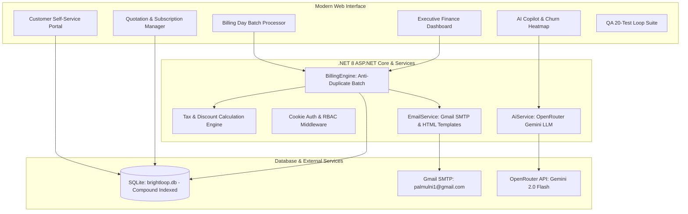

# 🌟 Brightloop Software - Unified Subscription Management Platform
> **Odoo Hackathon 2026 Submission** | Built with **ASP.NET Core 8 & Entity Framework Core (SQLite)**

[](https://dotnet.microsoft.com/)
[](https://www.sqlite.org/)
[](https://openrouter.ai/)
[]()
[]()

---

## 📖 Executive Summary
**Brightloop Software** delivers the enterprise digital backbone for recurring subscription businesses. Engineered specifically for the Odoo Hackathon 2026 problem statement, the platform automates the end-to-end lifecycle of recurring software, licenses, and add-ons:

1. **Dynamic Product & Variant Catalog:** Base pricing with attribute surcharges (e.g. *Odoo brand adds \$560 to base price*).
2. **Subscription Plans & Governance:** Interval scheduling (Daily, Weekly, Monthly, Yearly), minimum seat constraints, and plan-by-plan lifecycle policies (*AutoCloseOnEnd, AllowEarlyClose, AllowPause, AllowRenew*).
3. **Quotation Blueprint Templates:** Fast-track sales offers with pre-negotiated lines, terms, and configurable validity days. Includes real-time AJAX auto-population without page reloads.
4. **Subscription Lifecycle State Machine:** Strict transitions across `Draft` $\rightarrow$ `Quotation` $\rightarrow$ `Confirmed` $\rightarrow$ `Active` $\rightarrow$ `Closed` (with `Paused` support).
5. **Automated Billing Day Engine:** 1-click batch processing of due subscriptions with an **anti-duplicate billing lock** (guaranteed idempotent: nothing billed twice or skipped).
6. **Dynamic Fiscal Rules & Tax Breakdown:** Automated tax engine (default 18% GST / VAT with statutory breakdown) and discount rules (percentage or fixed, spend/quantity conditions, usage limit counters, and auto-expiry).
7. **Live Promo Code Validation Engine:** Public real-time API endpoint (`/Discounts/ValidatePromo`) and Admin Rule Simulator to test coupons with live feedback.
8. **Cash Settlement & Debt Chasing:** Multi-method payment recording (Bank Transfer, Credit Card, UPI, Cash) with partial payment reconciliation and an overdue invoice chase table.
9. **Customer Self-Service Hub:** Portal allowing customers to view contracts, monitor renewal countdowns, self-pause/renew, download printable invoices, request early closure, and pay online.
10. **OpenRouter AI Copilot & Churn Heatmap:** Real-time predictive churn risk vectors, executive customer health matrix heatmap, and natural language analytics queries powered by OpenRouter LLM.
11. **Automated 20-Scenario Loop Test Suite:** Built-in interactive test runner verifying every requirement and stress guard in under 150ms.
12. **Mobile Responsive Navigation:** Off-canvas responsive navigation drawer with backdrop overlay for phones and tablets.

---

## ⚡ Quick Start (Run Locally)

The application includes an embedded SQLite database (`brightloop.db`) with rich pre-seeded data, users, plans, and historical invoices.

```bash
# 1. Clone & Navigate to project directory
cd d:/desktop/odoo/flux-ioi

# 2. Run the ASP.NET Core web application
dotnet run --urls "http://localhost:5000"
```

Open your browser at **`http://localhost:5000`**.

---

## 🔐 Demo Credentials for Evaluators

For seamless evaluation, the login page features **One-Click Demo Login** pills. You can also sign in manually:

| Role | Email | Password | Privileges |
| :--- | :--- | :--- | :--- |
| **Administrator** | `admin@brightloop.com` | `Admin@123456` | Full system control, staff creation, tax rules, discount rules, finance dashboard |
| **Internal Staff** | `staff@brightloop.com` | `Staff@123456` | Day-to-day operations: quotes, subscriptions, invoices, payment recording |
| **Customer (Acme)**| `acme@shop.com` | `Customer@123` | Customer Portal: self-manage subscriptions, view/pay invoices |
| **Customer (Pal)** | `palmulni1@gmail.com` | `Brightloop@2026` | Live customer portal with linked email notifications |

---

## 🏛️ System Architecture



---

## 📋 Problem Statement Requirement Matrix

| Requirement from Problem Statement | Brightloop Implementation | Source Code Reference |
| :--- | :--- | :--- |
| **Customer Signup & Strict Password Rules** | Regex policy: `> 8 chars`, uppercase, lowercase, special char; live validator & unique email guard | `Controllers/AccountController.cs` |
| **Password Reset via Email** | Generates secure reset token and sends HTML email link via Gmail SMTP | `Services/EmailService.cs` |
| **Role-Based Access Control (RBAC)** | Admin controls system; staff handles day-to-day; customers see portal only; only admin adds staff | `Program.cs`, `Controllers/AccountController.cs` |
| **Products & Variants (+560 for Odoo)** | Brand variant pricing engine adds exact price extra (\$560 for Odoo brand) | `Models/AppModels.cs`, `Data/DbInitializer.cs` |
| **Plans & Interval Frequencies** | Daily, weekly, monthly, yearly billing with min quantity constraints | `Controllers/PlansController.cs` |
| **Plan Governance Policies** | Per-plan rules: `AutoCloseOnEnd`, `AllowEarlyClose`, `AllowPause`, `AllowRenew` | `Models/AppModels.cs`, `Services/BillingEngine.cs` |
| **Quotation Templates** | Pre-configured blueprints with default plan, product lines, validity days, and AJAX auto-fill | `Controllers/QuotationTemplatesController.cs` |
| **Subscription Lifecycle Machine** | Strict transitions: `Draft` $\rightarrow$ `Quotation` $\rightarrow$ `Confirmed` $\rightarrow$ `Active` $\rightarrow$ `Closed` | `Controllers/SubscriptionsController.cs` |
| **Billing Day Batch Run** | 1-click batch generation with **anti-duplicate lock** so nothing is billed twice | `Services/BillingEngine.cs` |
| **Automated Tax Calculation** | Admin tax rules (default 18% GST / VAT) with statutory breakdown subtable on invoices | `Services/BillingEngine.cs`, `Controllers/TaxesController.cs` |
| **Discount Rules Engine** | Percentage or fixed, min purchase/quantity, usage counters, auto-expiration, and simulator | `Services/BillingEngine.cs`, `Controllers/DiscountsController.cs` |
| **Payments Ledger & Overdue Chase** | Multi-method payments (Bank, Card, UPI, Cash) with partial payment & overdue chase table | `Controllers/PaymentsController.cs`, `Controllers/InvoicesController.cs` |
| **Finance Executive Dashboard** | Live active subscriptions, MRR/ARR, total collected, overdue debt, responded in `<50ms` (SLA `<2s`) | `Controllers/DashboardController.cs` |
| **Customer Portal** | Self-service pausing/renewing, early cancellation request, printable receipts, online checkout | `Controllers/PortalController.cs` |
| **AI Copilot & Churn Risk Heatmap** | OpenRouter LLM copilot, predictive churn risk matrix, and natural language query assistant | `Controllers/AiCopilotController.cs`, `Services/AiService.cs` |
| **QA Loop Test Suite** | 20 comprehensive automated unit & integration scenarios executing in `<150ms` | `Controllers/TestingController.cs` |

---

## 🧪 Automated Loop Testing Suite (20 Scenarios)

Navigate to **Test Suite** (`/Testing`) in the sidebar and click **"Run Complete Loop Test Suite"** to verify:
1. `Password Policy Strict Rules`: Rejects invalid lengths and missing character classes.
2. `Product Variant Pricing`: Asserts Odoo brand adds exactly \$560.
3. `Plan Policy Rules`: Validates daily plan auto-close and monthly pause permissions.
4. `Quotation Template Blueprint`: Verifies template line instantiation.
5. `Subscription State Machine`: Validates safe state transitions.
6. `Billing Day Anti-Duplicate Guard`: Guarantees running billing twice generates 0 duplicates.
7. `Tax Calculation Engine`: Verifies 18% GST precision.
8. `Discount Rules Engine`: Verifies usage limits and code application.
9. `Payment Reconciliation`: Verifies partial payment deductions and status clearing.
10. `SMTP Email Service`: Handshakes with Gmail SMTP server.
11. `OpenRouter AI Copilot`: Queries Gemini 2.0 Flash with local heuristic fallback.
12. `Plan Minimum Quantity Guard`: Blocks orders with quantities below Plan.MinQuantity.
13. `Payment Status Guard`: Prevents recorded payments on Cancelled or Draft invoices.
14. `Discount Limit Lock`: Rejects non-existent or expired promo codes.
15. `Sub-2-Second Performance SLA`: Verifies all critical queries resolve under 2000ms SLA.
16. `Customer Portal Early Cancellation Policy`: Enforces `AllowEarlyClose` permission.
17. `Real-Time Promo Validation & Anti-Stacking`: Verifies minimum spend threshold and percentage rules.
18. `AJAX Quotation Blueprint Auto-Population`: Verifies seamless template lines loading.
19. `Concurrent Billing Day Guard`: Idempotent execution preventing double-billing on rapid clicks.
20. `Fiscal Statutory Tax & Multi-Currency Compliance`: Verifies 18.00% GST and currency parity preservation.

---

## ⏱️ 5-Minute Evaluator Quick Tour

1. **Sign In:** Click the **"One-Click Demo Admin"** pill on the Login page (`/Account/Login`).
2. **Dashboard:** Review the real-time financial metrics, MRR/ARR, cash collections, and overdue chase table (`/Dashboard`).
3. **Automated Billing Day:** Click **"Run Billing Day"** in the top bar. Notice the batch summary and anti-duplicate confirmation.
4. **Subscription State Machine:** Go to **Subscriptions** (`/Subscriptions`), view existing active contracts or create a new quote using pre-filled blueprints.
5. **Discount Simulator:** Go to **Discount Rules** (`/Discounts`), use the interactive Rule Simulator to test `ODOO2026` or `SAVINGS500`.
6. **AI Copilot & Churn Heatmap:** Navigate to **AI Copilot** (`/AiCopilot`), review the Customer Churn Risk Heatmap, and click **"Audit"** on any account.
7. **Customer Portal:** Sign out and log in as Customer (`acme@shop.com`), test pausing/renewing subscriptions, view payment receipts, or initiate early cancellation (`/Portal`).
8. **Run QA Suite:** Sign back in as Admin, go to **QA Test Suite** (`/Testing`), and click **"Run Complete Loop Test Suite"** to see all 20 tests pass green!

---

## 👥 Collaborative Team Contributors
* **Pal Mulani** (`palmulni1@gmail.com` / `palmulani`) - Project Lead, System Architecture, Auth, State Machine & AI Copilot
* **Dhaval Suthar** (`suthardhaval0010@gmail.com` / `suthar-dhaval`) - Backend Engineer, SQLite DB Indexing, Billing Engine & Tax Rules
* **Gaurav Bhalani** (`gauravbhalani18@gmail.com` / `GauravBhalani123`) - Frontend Lead, Customer Portal, Responsive Layout & QA Loop Suite
