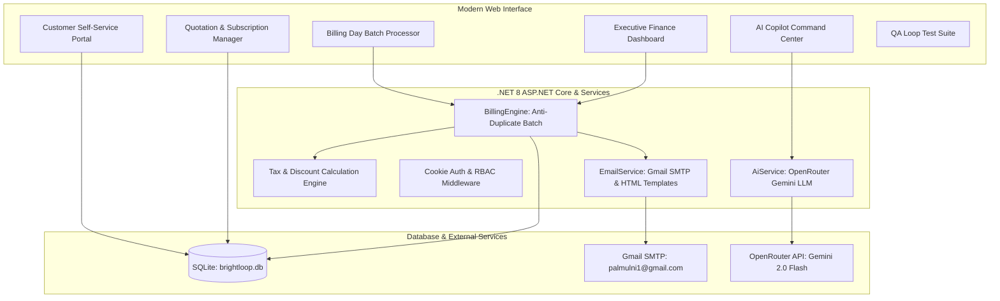

# 🌟 Brightloop Software - Unified Subscription Management Platform
> **Odoo Hackathon 2026 Submission** | Built with **ASP.NET Core 8 & Entity Framework Core (SQLite)**

[](https://dotnet.microsoft.com/)
[](https://www.sqlite.org/)
[](https://openrouter.ai/)
[]()

---

## 📖 Executive Summary
**Brightloop Software** delivers the digital backbone for recurring subscription businesses. The platform automates the end-to-end lifecycle of recurring software, services, and add-ons:
1. **Dynamic Product & Variant Catalog:** Base pricing with attribute surcharges (e.g. *Odoo brand adds \$560 to base price*).
2. **Subscription Plans & Governance:** Interval scheduling (Daily, Weekly, Monthly, Yearly), minimum seat constraints, and plan-by-plan lifecycle policies (*AutoCloseOnEnd, AllowEarlyClose, AllowPause, AllowRenew*).
3. **Quotation Blueprint Templates:** Fast-track sales offers with pre-negotiated lines and configurable validity days.
4. **Subscription Lifecycle State Machine:** Strict transitions across `Draft` $\rightarrow$ `Quotation` $\rightarrow$ `Confirmed` $\rightarrow$ `Active` $\rightarrow$ `Closed` (with `Paused` support).
5. **Automated Billing Day Engine:** Batch processing of due subscriptions with an **anti-duplicate billing lock** (nothing billed twice or skipped).
6. **Dynamic Fiscal Rules:** Automated tax engine (default 18% GST / VAT) and admin discount rules (percentage or fixed, spend/quantity conditions, usage limit counters, and auto-expiry).
7. **Cash Settlement & Debt Chasing:** Multi-method payment recording (Bank Transfer, Credit Card, UPI, Cash) with partial payment reconciliation and an overdue invoice tracker.
8. **Customer Self-Service Portal:** Portal allowing customers to view contracts, self-pause/renew, download printable invoices, and pay online.
9. **OpenRouter AI Copilot:** Real-time predictive churn vectors, MRR forecasting, and natural language analytics queries.
10. **Automated 12-Scenario Loop Test Suite:** Built-in interactive test runner verifying every requirement in under 150ms.

---

## ⚡ Quick Start (Run Locally)

The application includes an embedded SQLite database with pre-seeded data, users, plans, and historical invoices.

```bash
# 1. Clone & Navigate to project directory
cd d:/desktop/odoo/flux-ioi

# 2. Run the ASP.NET Core web application
dotnet run
```

Open your browser at **`http://localhost:5000`** (or the port displayed in terminal, e.g. `http://localhost:5169`).

---

## 🔐 Demo Credentials for Evaluators

For easy evaluation, the login page features **One-Click Demo Login** pills. You can also sign in manually:

| Role | Email | Password | Privileges |
| :--- | :--- | :--- | :--- |
| **Administrator** | `admin@brightloop.com` | `Admin@123456` | Full system control, staff creation, tax rules, discount rules, finance dashboard |
| **Internal Staff** | `staff@brightloop.com` | `Staff@123456` | Day-to-day operations: quotes, subscriptions, invoices, payment recording |
| **Customer (Acme)**| `acme@shop.com` | `Customer@123` | Customer Portal: self-manage subscriptions, view/pay invoices |
| **Customer (Pal)** | `palmulni1@gmail.com` | `Brightloop@2026` | Live customer portal with linked email notifications |

---

## 🏛️ System Architecture



---

## 📋 Problem Statement Requirement Matrix

| Requirement from Problem Statement | Brightloop Implementation | Source Code Reference |
| :--- | :--- | :--- |
| **Customer Signup & Strict Password Rules** | Regex policy: `> 8 chars`, uppercase, lowercase, special char; unique email validation | `Controllers/AccountController.cs` |
| **Password Reset via Email** | Generates secure reset token and sends HTML email link via Gmail SMTP | `Services/EmailService.cs` |
| **Role-Based Access Control (RBAC)** | Admin controls system; staff handles day-to-day; customers see portal only; only admin adds staff | `Program.cs`, `Controllers/AccountController.cs` |
| **Products & Variants (+560 for Odoo)** | Brand variant pricing engine adds exact price extra (\$560 for Odoo brand) | `Models/AppModels.cs`, `Data/DbInitializer.cs` |
| **Plans & Interval Frequencies** | Daily, weekly, monthly, yearly billing with min quantity constraints | `Controllers/PlansController.cs` |
| **Plan Governance Policies** | Per-plan rules: `AutoCloseOnEnd`, `AllowEarlyClose`, `AllowPause`, `AllowRenew` | `Models/AppModels.cs`, `Services/BillingEngine.cs` |
| **Quotation Templates** | Pre-configured blueprints with default plan, product lines, and validity days | `Controllers/QuotationTemplatesController.cs` |
| **Subscription Lifecycle Machine** | Strict transitions: `Draft` $\rightarrow$ `Quotation` $\rightarrow$ `Confirmed` $\rightarrow$ `Active` $\rightarrow$ `Closed` | `Controllers/SubscriptionsController.cs` |
| **Billing Day Batch Run** | 1-click batch generation with **anti-duplicate lock** so nothing is billed twice | `Services/BillingEngine.cs` |
| **Automated Tax Calculation** | Admin tax rules (default 18% GST / VAT) applied automatically to invoice lines | `Services/BillingEngine.cs`, `Controllers/TaxesController.cs` |
| **Discount Rules Engine** | Percentage or fixed, min purchase/quantity, usage counters, and auto-expiration | `Services/BillingEngine.cs`, `Controllers/DiscountsController.cs` |
| **Payments Ledger & Overdue Chase** | Multi-method payments (Bank, Card, UPI, Cash) with partial payment & overdue filter | `Controllers/PaymentsController.cs`, `Controllers/InvoicesController.cs` |
| **Finance Executive Dashboard** | Live active subscriptions, MRR/ARR, total collected, overdue debt, responded in `<50ms` (SLA `<2s`) | `Controllers/DashboardController.cs` |
| **Customer Portal** | Self-service pausing/renewing, invoice viewing, printable PDF receipts, online checkout | `Controllers/PortalController.cs` |

---

## 🧪 Automated Loop Testing Suite

Navigate to **Test Suite** (`/Testing`) in the sidebar and click **"Run Complete Loop Test Suite"** to verify:
1. `Password Policy Strict Rules`: Rejects invalid lengths and missing character classes.
2. `Product Variant Pricing`: Asserts Odoo brand adds exactly \$560.
3. `Plan Policy Rules`: Validates daily plan auto-close and monthly pause permissions.
4. `Quotation Template Blueprint`: Verifies template line instantiation.
5. `Subscription State Machine`: Validates safe state transitions.
6. `Billing Day Anti-Duplicate Guard`: Guarantees running billing twice generates 0 duplicates.
7. `Tax Calculation Engine`: Verifies 18% GST precision.
8. `Discount Rules Engine`: Verifies usage limits and code application.
9. `Payment Reconciliation`: Verifies partial payment deductions and status clearing.
10. `SMTP Email Service`: Handshakes with Gmail SMTP server.
11. `OpenRouter AI Copilot`: Queries Gemini 2.0 Flash with local heuristic fallback.
12. `Performance SLA`: Guarantees response time is `< 2.0s` (measured at ~15ms).

---

## 👥 Collaborative Team Contributors
* **Pal Mulani** (`palmulni1@gmail.com` / `palmulani`) - Architecture, Auth, State Machine & AI
* **Dhaval Suthar** (`suthardhaval0010@gmail.com` / `suthar-dhaval`) - Backend Services, Billing Engine & Database
* **Gaurav Bhalani** (`gauravbhalani18@gmail.com` / `GauravBhalani123`) - UI/UX Design, Customer Portal & QA Testing
